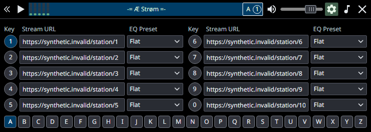
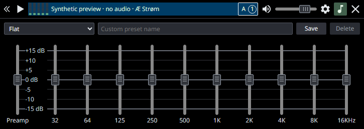

# Æ Strøm

Compact native Rust radio with Tæt UI and a Tauri WebView. Technical project/crate: ae-strom / ae_strom, version 0.1.2.

## Download for Windows

Portable Windows x64 builds are published on [GitHub Releases](https://github.com/edward-ap/ae-strom/releases). If no release is listed yet, use the source build below. Download **ae-strom.exe** and run it from a writable folder; WebView2 Runtime is required. No stations or personal settings are bundled. macOS and Linux binaries are not provided or verified.

### If WebView2 is unavailable

Before preparing a profile or starting Tauri/playback, the Windows app queries the WebView2 loader through Tauri's public API. An unavailable, failed or invalid version result produces a native **WEBVIEW2-RUNTIME** startup error with the [official Microsoft Evergreen download page](https://developer.microsoft.com/en-us/microsoft-edge/webview2/). The app does not download, install or open an installer automatically. Install/repair the Runtime yourself, then restart the player. Edge Stable alone is not a replacement for the Runtime.

## Run

Double-click **ae-strom.exe** in the project root. It is the complete application, with native audio, UI, fonts and assets embedded. No launcher, flags, Node server or separate web folder is needed. Normal mode is **live**, startup is **Stopped**, and playback begins only with Play.

Settings and stations live in **config.json next to the EXE**. The directory must be writable. Move the EXE and this file together to retain settings. Personal station data is never embedded in the binary or Git.

WebView2 browser data is generated separately under **%LOCALAPPDATA%/local.edwardap.ae-strom/webview/profile-<id>/** on Windows. Each absolute profile location gets its own browser directory and lock. Browser caches are distinct from the Rust station config. The Windows WebView2 runtime remains required; Node, React and separate UI files are not required at runtime.

The previous **local-data/player/config.json** is supported without modifying it. If the adjacent config is absent, startup validates and migrates that previous profile, keeps a verified `.bak`, and records the migration in AppData. On subsequent launches the adjacent config wins while the acknowledged previous file remains unchanged. If both files already differ without a matching migration record, or the previous file later changes, startup reports a conflict and preserves both files. See [configuration migration and recovery](docs/CONFIG_STORAGE.md).

The development target/release EXE uses the project-root config when normal Cargo source markers exist. A plain distribution uses its own EXE directory, independently of the working directory. **--data-dir <absolute-directory>** explicitly selects that directory's config and disables previous-profile discovery. Fake playback remains opt-in with **--fake**, using separate local-data/preview by default; its WebView cache is still in per-profile AppData. **--import-config <source-file>** validates into a fresh destination and never overwrites a different existing config. There is no fallback to an empty or alternate profile after a parse, schema, conflict or write error.

## Build and test from a clean clone

The commands below target **Windows x64**. Install a Rust MSVC toolchain and Microsoft C++ Build Tools with the Desktop development with C++ workload and a Windows SDK. The checked toolchain is Rust/Cargo **1.96.0**. Windows WebView2 Runtime is needed to run the app or native UI checks. See the [official Tauri Windows prerequisites](https://v2.tauri.app/start/prerequisites/).

### Build the full EXE using the committed UI

Run from a developer terminal:

```text
git clone https://github.com/edward-ap/ae-strom.git ae-strom
cd ae-strom
cargo build --release --locked --bin ae-strom
```

This path needs **no Node/npm installation or frontend generation**: all application JS/CSS and pinned Tæt assets are committed under `web/`. Cargo embeds them into **target/release/ae-strom.exe**. `live-audio` and `custom-protocol` are default features. Cargo downloads locked Rust dependencies on the first build; add `--offline` only when those sources are already cached. Preserve **Cargo.lock**.

Copy the full EXE to a writable portable folder after preserving the previous version and closing its player. A clean clone contains no personal stations; configure or explicitly import your own settings. See [installation/profile selection](docs/INSTALL.md). No application launch is required to build.

### Where Tæt comes from

The npm package is **taet-ui**, pinned to **0.6.0-rc.7** in [package.json](package.json) and [package-lock.json](package-lock.json). It is a **development dependency** used to reproduce vendored assets. Runtime imports use **web/vendor/taet-ui.js** and **web/vendor/taet-ui.css**, with bundled fonts, declarations and licenses; they do not resolve `node_modules` or contact npm.

For development, install Node **22+** with npm, then use the lockfile:

```text
npm ci --include=dev --ignore-scripts
npm run vendor
npm run test:vendor
```

`npm ci` already installs **taet-ui@0.6.0-rc.7**, esbuild, the optional icon CLI and the test/type tools. No separate `npm install taet` step is needed. Keep optional dependencies enabled: esbuild and the icon CLI use platform-specific binary packages. Preserve **package-lock.json**; do not use `--omit=dev` for this workflow. npm lifecycle install hooks are disabled, while explicitly requested `npm run` commands still execute. See [npm ci](https://docs.npmjs.com/cli/v11/commands/npm-ci/).

`npm run vendor` verifies the published package's integrity and pinned source hashes, regenerates the components ESM/CSS with **esbuild 0.28.2**, and checks the six canonical runtime assets and 85 declaration files against the committed manifest. It requires that manifest to exist. A clean clone already includes it; recover missing vendor/manifests from the same Git revision before regeneration. Regeneration should leave the tracked vendor files unchanged.

Upgrading Tæt is a separate reviewed vendoring change, not an automatic update command. The package/lockfile, published-source provenance, expected asset/type hashes and version guards in the generator/checker must be updated together. The current regeneration script deliberately accepts only the pinned rc.7 delivery. See [BUILD.md](docs/BUILD.md) for the files involved.

### Run development checks

Browser tests additionally need the Playwright Chromium version matching the lockfile. If it is not already cached, install it once using the [official browser installer](https://playwright.dev/docs/browsers):

```text
npx playwright install chromium
npm test
cargo fmt --check
cargo test --release --locked --all-targets
cargo test --release --locked --doc
cargo clippy --release --locked --all-targets
```

`npm test` runs syntax, public types, vendor integrity and synthetic browser tests at 100/150% scaling, including favicon transparency. Playwright Chromium is a **development test browser**, separate from the Windows WebView2 runtime. Existing inherited Clippy warnings are documented; `-D warnings` is not currently a passing gate.

Browser preview is `npm run preview` and uses fake data. Optional native `.ps1` acceptance scripts are described in [BUILD.md](docs/BUILD.md); run them only where script policy permits. They are not required for Cargo compilation or the browser suite. Do not change or bypass Execution Policy to run them. The clone verification used no real radio or personal profile; macOS/native OS-input parity is not claimed.

Application artwork and reproducible desktop formats: [icons/README.md](icons/README.md). Use `npm run icons` only when regenerating the committed icon assets; normal Cargo builds use those assets directly.

For the standalone CMD metadata inspector, see [icy_peek](docs/ICY_DIAGNOSTICS.md).
It logs ICY headers, raw blocks and track changes without opening an audio device
or modifying the player's profile. See [CHANGELOG.md](CHANGELOG.md) for changes.

The player requests ICY on the audio connection and uses it exclusively when
the server advertises `icy-metaint`. Otherwise it reads the played stream's
container tags, including FLAC/Ogg title updates. Configured
`metadataType`/`metadataUrl` and automatic discovery are fallback sources only
when neither supplies a track title. Independent fallback streams have no
universal synchronization guarantee. Container station names fill empty config
names; existing names are preserved.

Settings station fields show the saved station name while unfocused, or the URL
when no name is known. Focusing a field reveals its stream URL for editing;
leaving restores the name. Only genuine edits are saved on Enter or blur.
Unsaved or rejected URL drafts remain visible for correction, and metadata
updates do not overwrite a focused editor's text or selection.

## Ultra-compact mode

Click the **double-chevron button to the left of Play/Stop** to collapse the same player window to **102 × 36 logical pixels**. Only the expand chevron, Play/Stop button and five-band spectrum remain visible. Physical pixel dimensions depend on Windows display scaling.

Expansion keeps the right edge fixed when there is space to the left; near the left edge it grows right instead. If neither anchor fits, the position is adjusted into the current monitor's work area. Settings and EQ open above the player when the current monitor has insufficient working space below; closing them leaves the player strip in place.

Playback continues in the same Rust session. The current station, volume/mute, EQ settings and unsaved editor drafts are retained; collapsing does not stop or reconnect the stream. Click the chevron again to restore the full player and its previous panel. Settings, EQ and the remaining controls are available after expansion. The compact background/spectrum can still be used to drag the window.

## Screenshots

These reference images use synthetic preview data, with no personal station list. Replace the files under **docs/images** to update the README images; keep the same names so the relative links continue to work.

Normal player:


Ultra-compact mode (102 × 36 logical pixels):


Station settings:



Equalizer:



## Interface and framework

When stopped without an error, the ticker shows **-= Æ Strøm =-** centered and still. Connection/reconnection messages, errors and playing track titles retain the normal ticker behavior.

- A–Z banks with ten slots; active playback and Settings browsing are separate.
- Play/Stop, volume/mute, scrolling title and full-title Ctrl+C outside editors.
- Ten-band EQ/preamp, custom presets and per-station assignments.
- Frameless always-on-top window with noninteractive chrome drag and compact mode preserving state/drafts.
- Physical A–Z keys, 1–9/0 slots, +/- volume and * mute, with editor/composition guards.

Normal 725×36, compact 102×36, Settings 725×258, EQ 725×257 logical px. Noto Sans 12 px is bundled. Specialized SpectrumAnalyzer and ChannelIndicator remain app-owned on one BaseControl identity.

Tæt UI is pinned to published **taet-ui@0.6.0-rc.7**, components ESM, source 53c5b177a5b68f1c1779afe97316480c65101840. Runtime assets, public declarations, source hashes and npm integrity are checked. Technical dui CSS/DOM names are retained. See [BUILD.md](docs/BUILD.md), [ARCHITECTURE.md](docs/ARCHITECTURE.md), [CONSUMER_NOTES.md](docs/CONSUMER_NOTES.md) and [VERIFICATION.md](docs/VERIFICATION.md).

Typography: bundled standard Noto Sans variable at 12 px. [Font audit and native/macOS limits](docs/FONT_AUDIT.md) records actual loading/rendering evidence and intentional OS fallback.

## License

MIT; see [LICENSE](LICENSE). Binary release attribution and corresponding third-party source links: [third-party components](docs/THIRD_PARTY.md).
